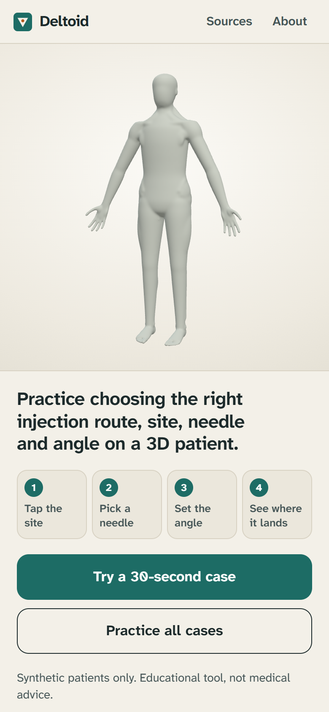
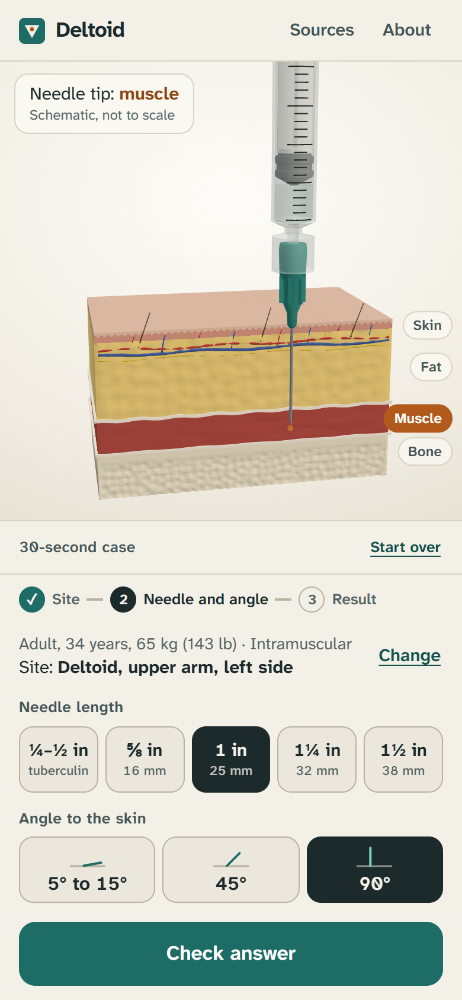
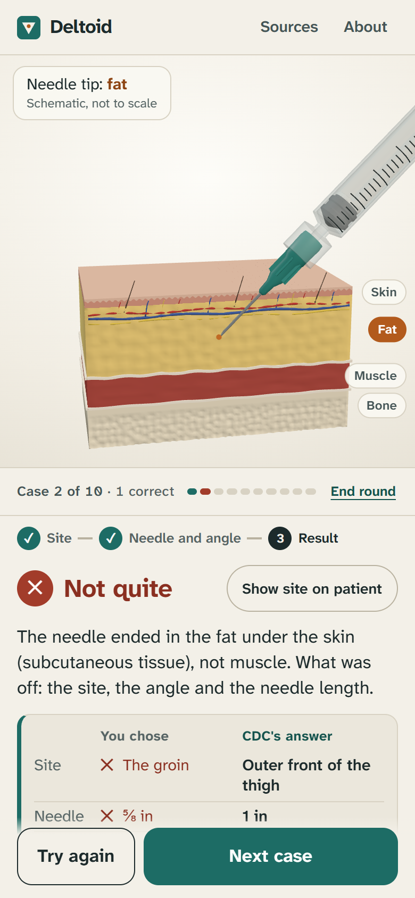
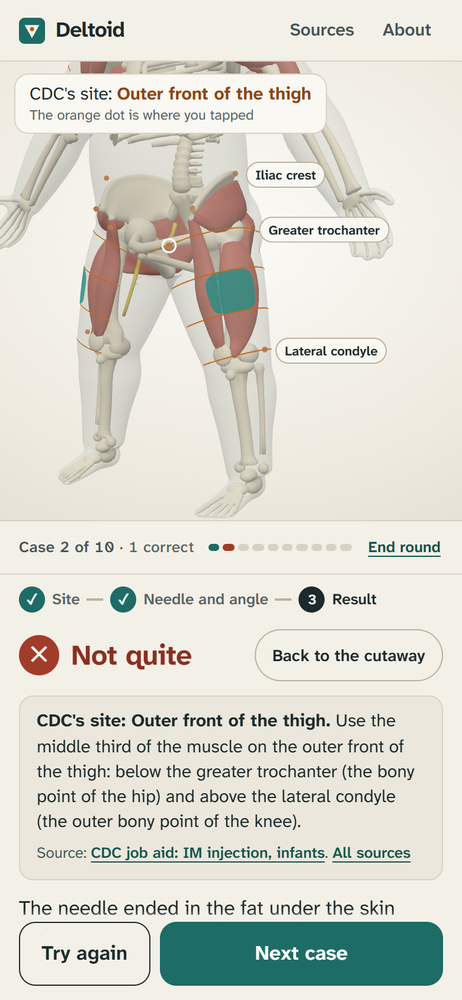
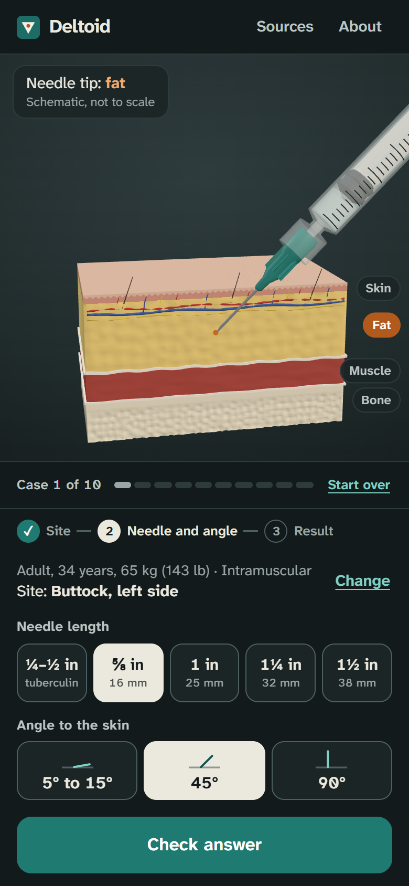
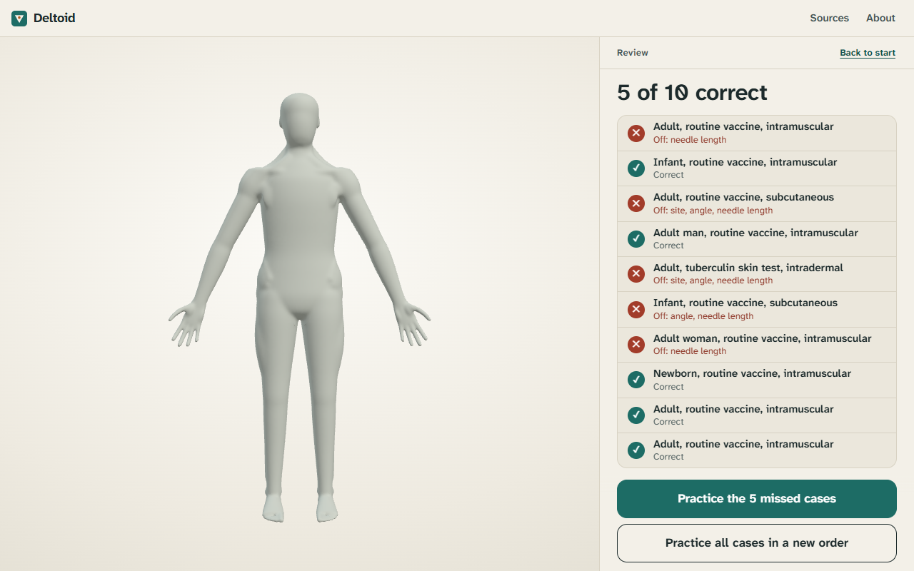
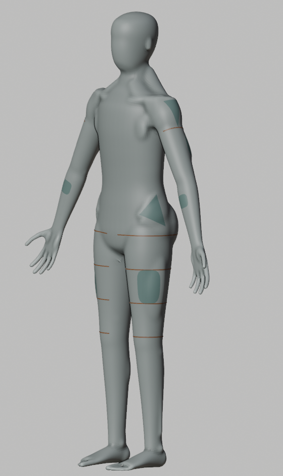
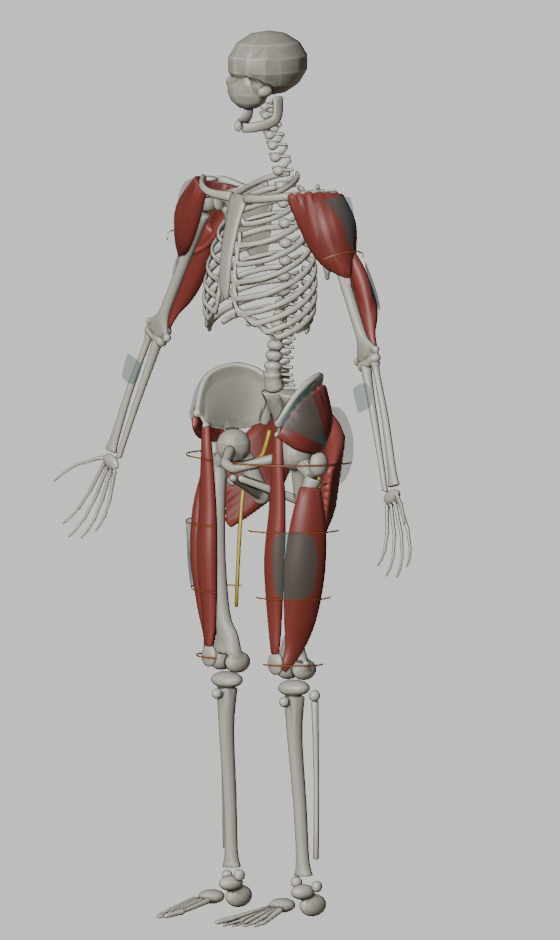
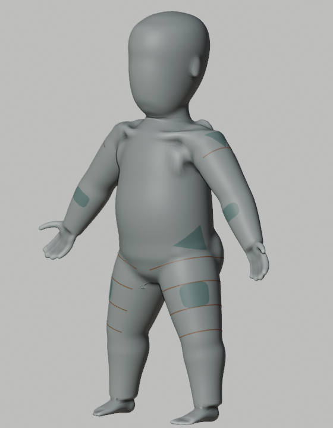
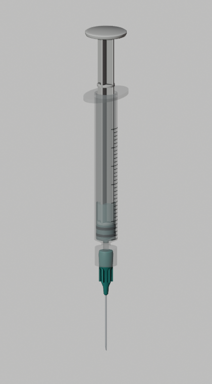

# Deltoid

A 3D injection site trainer for medical assistants. Pick the route, tap the site on a 3D patient, choose a needle and an angle, and see in a cutaway which tissue the needle reaches. Every answer is checked against CDC guidance and shows its source.

**Live:** https://deltoid-eight.vercel.app (no login; opens on a phone)

<p>
  
  
  
  
</p>
<p>
  
  
  
</p>

## Important

> **All patients are synthetic. No real patient data is used or collected.**
>
> **Educational tool. Not medical advice, not a medical device, and not a substitute for supervised clinical training or your employer's procedures.**

## Why it exists

Giving an injection means making three decisions together, and each depends on the patient:

- **Where.** The site depends on the route and the patient's age. An adult's routine intramuscular vaccine goes in the deltoid; most infants under 12 months get it in the outer front of the thigh.
- **How long a needle.** For injections into muscle, CDC lists lengths by age and, for adults, by weight and sex. A 1 inch needle is right for a 65 kg adult and too short for a 95 kg woman.
- **What angle.** 90 degrees into muscle, 45 degrees into the fat under the skin, 5 to 15 degrees into the skin itself.

Those rules are spread across several CDC job aids, tables and guidelines. Deltoid puts them into one place to practise. Each case is a patient with a route, the learner makes all three choices, and the result shows what the needle reached and explains every part against the CDC text, with a link to it.

## A case, step by step

1. **Read the case card.** It names the patient (for example "Man, 47 years, 100 kg (220 lb)"), the scenario and the route, with the route explained in plain words ("into the muscle"). Some cases add a constraint, such as "Neither upper arm can be used today."
2. **Tap the site.** The camera starts on the body. Body, Arm, Thigh and Hip buttons move it, and you can drag to turn and pinch to zoom. "Show landmarks" makes the skin translucent and shows the bones, muscles and labelled bony points underneath. When you tap, a marker drops on the skin and the panel names what you tapped. A short bar fills, then the needle step opens. If the 3D view is hard to use, "Choose the site from a list instead" offers the same sites as buttons.
3. **Pick a needle and an angle.** Needles run from the tuberculin needle (¼ to ½ inch) to 1½ inch, with millimetres under each inch label. Each angle button has a small drawing of the needle meeting the skin. The camera turns to a cutaway of skin, fat, muscle and bone, and the syringe moves as you choose, so you see where the tip will end before you commit. Until both are chosen, the check button says what it is waiting for.
4. **Check the answer.** The result says "Correct" or "Not quite", which tissue the needle ended in, and what was off. After a miss, a table puts what you chose beside CDC's answer for the site, needle and angle, each marked right or off. Below that is one line for each part with the CDC wording behind it and its sources.
5. **See the site.** "Show site on patient" switches the 3D view from the cutaway back to the patient: landmarks on, only CDC's injection area drawn, the camera turned to it, and your own tap still marked. The panel adds CDC's description of how to find the site.

The 30-second case on the first screen is this flow with one adult patient, and takes four taps after it opens. Practice mode runs all ten cases, in the written order the first time and in a new order on each repeat.

## What it does

- **Ten practice cases.** Adults and infants across intramuscular, subcutaneous and intradermal routes (see the table below). A bar per case tracks correct and missed answers, and a step indicator shows where you are inside a case.
- **Specific feedback.** Not just right or wrong. A wrong site is explained ("For most infants under 12 months, CDC recommends the outer front of the thigh, because it has more muscle than the deltoid"). So is a needle that is too short to reach the muscle, or longer than CDC lists for that patient, and a tap that missed every injection area is named by body region ("the upper third of the thigh").
- **Learn from misses.** "Try again" reruns a missed case. The retry is graded but does not change the score. The review lists every case with what was off, repeats each miss with your answer beside CDC's, and offers a round of just the missed cases.
- **Stop when you need to.** Once a case is answered, "End round" opens the review for the cases done so far, so leaving early does not throw the round away.
- **Landmarks on demand.** "Show landmarks" reveals the skeleton, the injection muscles and the labelled bony landmarks: acromion, armpit fold, elbow joint, greater trochanter, iliac crest, anterior superior iliac spine and lateral condyle.
- **Sources everywhere.** Every line of feedback carries the CDC documents it came from. The Sources screen lists each one with its publisher, date and access date.
- **Phone first.** Controls are at least 44 px and sit in the lower half of the screen, under the thumb. On the review the 3D view shrinks to a strip so the list has room. On a desktop the controls move to a side panel.
- **Light and dark.** The theme follows the device setting.

<p>
  
</p>

No backend, no account, no cookies, no analytics. Progress lives in memory and is gone on reload.

## The cases

All ten are in [`src/content/clinical.ts`](src/content/clinical.ts). The answer column is what the app shows as "CDC's answer"; it is computed from the same rules the grader uses.

| # | Patient | Route | CDC's answer |
| --- | --- | --- | --- |
| 1 | Adult, 34 years, 65 kg | Intramuscular | Deltoid, 1 in, 90° |
| 2 | Infant, 6 months | Intramuscular | Outer front of the thigh, 1 in, 90° |
| 3 | Adult, 52 years, 68 kg | Subcutaneous | Upper outer triceps area, ⅝ in, 45° |
| 4 | Man, 47 years, 100 kg | Intramuscular | Deltoid, 1 to 1½ in, 90° |
| 5 | Adult, 28 years, 62 kg | Intradermal (tuberculin skin test) | Inner forearm, ¼–½ in, 5° to 15° |
| 6 | Infant, 9 months | Subcutaneous | Outer front of the thigh, ⅝ in, 45° (triceps area also accepted) |
| 7 | Woman, 61 years, 95 kg | Intramuscular | Deltoid, 1½ in, 90° |
| 8 | Newborn, 2 weeks | Intramuscular | Outer front of the thigh, 1 in, 90° (⅝ in accepted with stretched skin) |
| 9 | Adult, 23 years, 55 kg | Intramuscular | Deltoid, 1 in, 90° (⅝ in accepted with stretched skin) |
| 10 | Adult, 40 years, 66 kg, neither arm usable | Intramuscular | Outer front of the thigh, 1½ in, 90° (1 in accepted with stretched skin) |

In the adult intramuscular cases the thigh is accepted as CDC's alternative site, with a note saying so, and the needle is then graded against CDC's thigh lengths rather than the deltoid's.

## How grading works

All clinical content is in one typed file, [`src/content/clinical.ts`](src/content/clinical.ts): routes, sites, needles, angles, needle rules by patient group, the ten cases and every feedback sentence. Each entry carries the CDC sources it was read from. The grader, [`src/lib/grading.ts`](src/lib/grading.ts), reads only that file and contains no clinical values of its own.

An answer is correct when all three parts match the cited guidance:

| Part | Rule |
| --- | --- |
| Site | The tap is tested against the injection area meshes inside the 3D model, the same shapes shown by "Show landmarks". If the tap itself misses, the app looks 5 px and then 10 px around it, because a fingertip is wider than a pixel. A site is either CDC's recommended site, an accepted alternative (correct, with a note), or not used for this patient (wrong, with CDC's reason). |
| Angle | One angle per route: 90 degrees into muscle, 45 degrees into the fat under the skin, 5 to 15 degrees into the skin for the tuberculin skin test. |
| Needle length | For injections into muscle, CDC lists lengths by age and, for adults, by weight and sex: seven patient groups from newborn to a woman over 90 kg. Where CDC allows a shorter needle only with a stated technique, such as ⅝ inch for an adult under 60 kg with the skin stretched tightly, the answer is accepted and the condition is shown. Subcutaneous is ⅝ inch at every age; the tuberculin skin test uses a ¼ to ½ inch needle. |

### The cutaway

**The cutaway is a schematic, not to scale.** CDC publishes needle lengths, not tissue depths, so the layer boundaries are derived from the needle rules for the patient in the case. Muscle begins halfway between the longest needle that is too short and the shortest one CDC lists; bone begins halfway past the longest one listed. That way the picture can never disagree with the verdict.

A worked example, for the 65 kg adult in case 1. CDC lists only 1 inch (25 mm) for the deltoid, so muscle starts at 20.5 mm (halfway between ⅝ inch, 16 mm, and 25 mm) and bone at 28.5 mm (halfway to 1¼ inch, 32 mm). At 90 degrees the tip depth is the full needle length:

| Needle at 90° | Tip depth | Ends in |
| --- | --- | --- |
| ⅝ in | 16 mm | Fat |
| 1 in | 25 mm | Muscle |
| 1¼ in | 32 mm | Bone |

At 45 degrees the depth is the length times sin 45°, so a 1 inch needle reaches about 17.7 mm and stays in fat. At 5 to 15 degrees only the bevel goes under the skin, as CDC describes for the tuberculin skin test.

## Sources

Every value was read from these pages on 15 November 2026. The app lists them on its Sources screen with links and access dates.

| Source | Used for |
| --- | --- |
| [General Best Practice Guidelines for Immunization: Vaccine Administration](https://www.cdc.gov/vaccines/hcp/imz-best-practices/vaccine-administration.html) (CDC, ACIP) | Angles, sites by age, needle length by age and adult weight, gauges |
| [Pink Book, Chapter 6: Vaccine Administration](https://www.cdc.gov/pinkbook/hcp/table-of-contents/chapter-6-vaccine-administration.html) (CDC) | Subcutaneous technique, ventrogluteal landmarks, why the buttock is not used |
| [You Call the Shots: IM injection, adults](https://www.cdc.gov/vaccines/hcp/admin/downloads/IM-injection-adult.pdf) (CDC) | Deltoid landmarks, adult needle lengths |
| [You Call the Shots: IM injection, infants](https://www.cdc.gov/vaccines/hcp/admin/downloads/IM-Injection-Infants-508.pdf) (CDC) | Thigh landmarks, infant and newborn needle lengths |
| [You Call the Shots: subcutaneous injection](https://www.cdc.gov/vaccines/hcp/admin/downloads/YCTS-VaxAdmin-Subcut-injection.pdf) (CDC) | Subcutaneous site, needle and angle |
| [Mantoux Tuberculin Skin Test wall chart](https://www.cdc.gov/tb/education/mantoux/pdf/Mantoux_TB_Skin_Test.pdf) (CDC) | Intradermal site, needle and angle |
| [Tuberculin skin test clinical guidance](https://www.cdc.gov/tb/hcp/testing-diagnosis/tuberculin-skin-test.html) (CDC) | Intradermal route and site |

The PDFs were read in full. The two web pages were read as full page text, including the Pink Book's collapsed sections and both of its needle tables with footnotes, and every statement that cites them was compared with that text.

Left out because CDC does not give a value: volume limits per site, intradermal vaccines (CDC states none is routinely recommended, so the intradermal case is the tuberculin skin test), and tissue layer thickness. No drug dosing and no drug names.

## Accessibility

- Every control is a native button with a visible text label, and the site can be chosen from a list, so no step depends on using the 3D view.
- A case can be answered with the keyboard alone. Each step takes focus as it opens, so Tab carries on from the step's own controls instead of the top of the page. On the site step the 3D view can be focused: the arrow keys turn the patient, plus and minus zoom.
- Status changes (the site you marked, the result) are in live regions for screen readers. The 3D view has a text description that changes with the step and points to the site list.
- Text meets WCAG AA contrast in both the light and the dark theme. This is measured, not assumed: the scripted checks walk the main screens in each theme and compare every piece of visible text with what is painted behind it.
- With reduced motion requested, the patient does not turn on its own, camera moves are instant, step transitions are off, and the wait before the needle step drops from 800 ms to 250 ms.
- Atkinson Hyperlegible Next, a typeface designed for low-vision readers, is self-hosted.
- If WebGL is unavailable, the app says so plainly and names browsers to try instead of showing a blank canvas.

## How the models were made

Everything 3D was modelled in Blender 5.3 with Python build scripts, kept in [`assets/blender/scripts`](assets/blender/scripts) next to the `.blend` sources.

<p>
  
  
  
  
</p>

- **Patients.** An adult and an infant, with no face and no likeness to a real person. The trunk and limbs are lofted through elliptical sections; superficial muscles, bony points, fingers and toes are fused on with a voxel remesh; the result is retopologised to an all-quad mesh (QuadriFlow) and shrink-wrapped back onto the detailed surface.
- **Anatomy.** A skeleton (including the scapula with its acromion, the pelvis with iliac crest and anterior superior iliac spine, and the femur with its greater trochanter), the deltoid, triceps, vastus lateralis, rectus femoris, gluteus medius and maximus, and the sciatic nerve, each as its own named mesh. The anatomy is written once for the adult and mapped onto the infant's joints.
- **Landmarks and injection areas.** Named empties sit on the skin over each bony landmark. Injection areas are surface patches projected onto the finished body. The deltoid area, for example, is centred 2 inches below the acromion and ends at armpit level, as the CDC job aid describes. The app reads these objects by name, so it grades against the geometry the learner sees.
- **Body regions.** The rest of the skin is divided into named regions (head, upper arm, upper third of the thigh and so on), so a tap outside every injection area can still be described in words.
- **Tissue cutaway.** Epidermis, dermis, fat, fascia, muscle, periosteum and bone as separate meshes, with hair follicles, small vessels and a nerve.
- **Syringe.** Needle, hub, barrel, graduations, stopper, plunger and fluid as separate meshes, so the needle can be scaled and the plunger moved.

Export is glTF binary, Y up, transforms applied, in metres, then meshopt compression. All six files total 1.26 MB (about 0.8 MB over the wire), under the 1.5 MB budget that `npm run models:compress` enforces.

| File | Contents | Loaded |
| --- | --- | --- |
| `adult.glb`, `infant.glb` | Body, injection areas, landmarks, regions, camera views | When the patient is first shown |
| `adult_anatomy.glb`, `infant_anatomy.glb` | Skeleton, muscles, sciatic nerve | In the background during the site step; shown with "Show landmarks" |
| `tissue.glb`, `syringe.glb` | Cutaway layers and syringe | In the background during the site step; shown at the needle step |

The first screen needs only the adult body. Everything else is fetched while the learner is reading the case or looking for the site, so the needle step opens without a wait.

## How it is built

```
clinical.ts ──► grading.ts ──► Trainer.tsx ──► Stage3D.tsx ──► stage.ts (three.js)
 CDC rules,      verdict,        flow and        React wrapper:   scene, camera,
 cases, copy,    findings,       screens         loading, errors, picking,
 sources         cutaway depths  (useReducer)    fallbacks        cutaway, syringe
```

- **Flow.** One reducer holds the whole session: the screen (home, case, review), the step inside a case (site, needle and angle, result), the round's queue of cases, and every attempt with whether it counts toward the score. A round of missed cases is the same flow with a shorter queue.
- **3D.** Plain three.js, not a React wrapper. The engine is loaded with a dynamic import after the first paint, frames are drawn only when something changes, and the device pixel ratio is capped at 2. A tap is told from a drag by how far the finger moved (more than 9 px is a drag), not by how long it was down, so slow taps still count and quick drags never place a site.
- **Pages.** Next.js App Router with TypeScript, statically rendered and deployed on Vercel. The trainer, Sources and About are the only pages.
- **Lighthouse** mobile on the live first screen (16 November 2026): performance 98, accessibility 100, best practices 100.

## Testing

`npm run e2e` drives the real app in Edge or Chrome, through `playwright-core`, and saves screenshots. It runs 45 checks in eight set-ups:

| Set-up | What it checks |
| --- | --- |
| Phone, 390×844, touch | The first screen fits without scrolling and every control is at least 44 px. A drag and a pinch do not place a site. Landmark labels stay clear of the controls. The 30-second case is answered correctly in four taps, with the tap landing in the deltoid area and the cutaway reporting muscle. The check button says what it is waiting for. A wrong answer names the tissue and what was off and shows CDC's answer. CDC's site can be shown on the patient, with landmarks and how to find it, and the cutaway comes back. Try again keeps the score. End round opens a review of the cases answered so far, with the 3D view stepped back, and a repeat round opens on a different case. About carries the synthetic-data and educational statements, Sources lists every citation with a link and access date, and there are no console errors. |
| Desktop, 1280×800 | The side panel flow, choosing the site from the list. A full ten-case practice run, then the review with every case, each miss with CDC's answer and sources, and a round of just the missed cases. |
| Keyboard only, 1280×800 | With Tab, Shift+Tab and Enter alone: start a case, turn the patient with the arrow keys, pick the site from the list, pick the needle and angle, and check the answer. Focus is on each step as it opens. |
| Contrast, light theme | Every piece of visible text on the first screen, the site step, the needle step, a missed result, the site view, the review, Sources and About is at least 4.5:1 against what is painted behind it (3:1 for large text). The audit first proves itself on a grey-on-grey sample. |
| Contrast, dark theme | The same walk with the device set to dark, and the page really is dark. |
| Small phone, 360×640 | The first screen still fits and the view buttons stay on screen. |
| WebGL unavailable | A clear message appears instead of a blank canvas. |
| Reduced motion | The patient does not turn on its own. |

Changes are linted, built and run through these checks before their pull request is merged. The same script runs against the live site by passing its URL.

## Run it locally

Requires Node.js 20.9 or later.

```bash
npm install
npm run dev
```

Then open http://localhost:3000.

| Script | What it does |
| --- | --- |
| `npm run build` | Production build |
| `npm run lint` | ESLint |
| `npm run e2e -- http://localhost:3000` | The scripted touch checks above (needs Edge or Chrome installed) |
| `npm run models:compress` | Recompress the Blender exports into `public/models` and check the size budget |

To rebuild the models, open Blender, add `assets/blender/scripts` to the Python path and run `build_patient.build("adult")`, `build_patient.build("infant")`, `build_tissue.build()`, `build_syringe.build()` and `export_all.run(...)`.

## Project layout

```
assets/blender/      Blender sources, build scripts and preview renders
public/models/       Compressed .glb models
src/content/         clinical.ts: all clinical content with sources
src/lib/             grading.ts: grading and the cutaway model
src/three/           stage.ts: the 3D engine
src/components/      Trainer (flow and screens), Stage3D (3D view)
src/app/             Pages: trainer, Sources, About
tools/               Model compression and the scripted touch checks
docs/                Screenshots used in this README
```

## Limits

- Tested in emulated phone and desktop browsers, not yet on a range of physical phones. Keyboard use is covered by a scripted run, but it has not been tried with a screen reader.
- The contrast audit measures text over the 3D view against its own label background, not against the pixels of the 3D scene behind it.
- Covers only what CDC's vaccine administration and tuberculin skin test sources state. It does not grade volume, aspiration, skin preparation, or anything drug-specific.
- The two patients are generic body shapes. Real patients vary, which is why CDC's needle rules are by weight and why clinical judgement and supervised training still apply.
