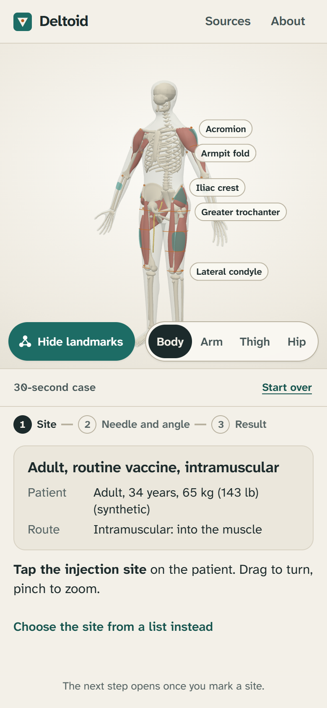
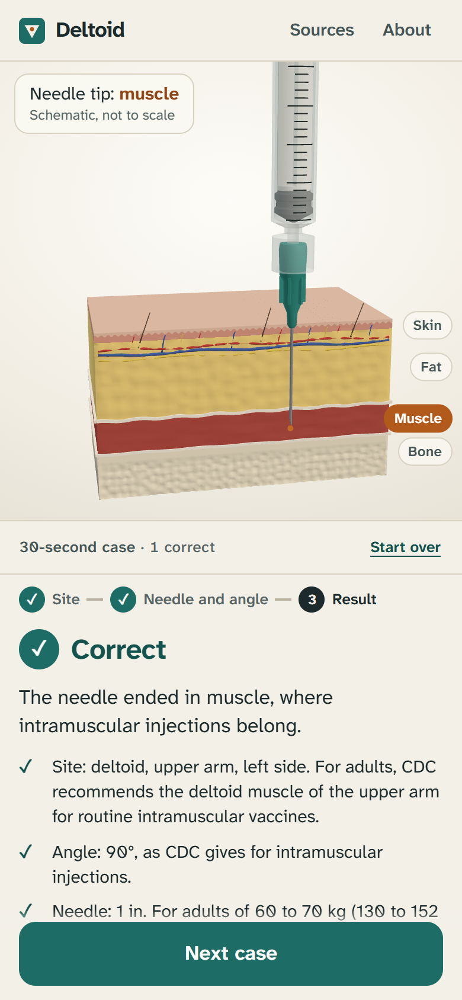

# Deltoid

A 3D injection site trainer for medical assistants. Pick the route, tap the site on a 3D patient, choose a needle and an angle, and see in a cutaway which tissue the needle reaches. Every answer is checked against CDC guidance and shows its source.

**Live:** https://deltoid-eight.vercel.app (no login; opens on a phone)

<p>
  
  
  
  
</p>

## What it does

- **A 30-second case.** One synthetic patient, four taps: the site, the needle length, the angle, and "Check answer". The first screen shows those four steps before you start.
- **Practice mode.** Ten cases mixing adults and infants across intramuscular, subcutaneous and intradermal routes. A bar per case tracks correct and missed answers, and a step indicator shows where you are inside a case.
- **Specific feedback.** The result says which tissue the needle ended in and what was off (site, angle or needle length), with a link to the CDC page it comes from. After a miss it shows CDC's answer (site, needle, angle) straight away.
- **Learn from misses.** "Try again" reruns a missed case without changing the score. The review lists every case, explains each miss, and offers a round of just the missed cases.
- **Landmarks on demand.** "Show landmarks" makes the skin translucent and reveals the skeleton, the injection muscles and the labelled bony landmarks: acromion, greater trochanter, iliac crest, anterior superior iliac spine, and the thirds of the thigh.
- **Phone first.** Tap to select, drag to turn, pinch to zoom. A tap is told from a drag by how far the finger moved, not by time. Controls are at least 44 px and sit in the lower half of the screen.

<p>
  
</p>

No backend, no account, no cookies, no analytics. Progress lives in memory and is gone on reload.

## Important

> **All patients are synthetic. No real patient data is used or collected.**
>
> **Educational tool. Not medical advice, not a medical device, and not a substitute for supervised clinical training or your employer's procedures.**

## How grading works

All clinical content is in one typed file, [`src/content/clinical.ts`](src/content/clinical.ts). Each entry carries the CDC source it was read from, with URL and access date. The grading in [`src/lib/grading.ts`](src/lib/grading.ts) reads only that file.

An answer is correct when all three parts match the cited guidance:

| Part | Rule |
| --- | --- |
| Site | The tap is tested against the injection area meshes inside the 3D model, the same shapes shown by "Show landmarks". Because a fingertip is wider than a pixel, a tap within 10 px of an area's edge counts. |
| Angle | One angle per route: 90 degrees into muscle, 45 degrees into the fat under the skin, 5 to 15 degrees into the skin for the tuberculin skin test. |
| Needle length | For injections into muscle, CDC lists lengths by age and, for adults, by weight and sex. Where CDC allows a shorter needle only with a stated technique, the answer is accepted and the condition is shown. |

**The cutaway is a schematic, not to scale.** CDC publishes needle lengths, not tissue depths, so the layer boundaries are derived from the needle rules for the patient in the case: muscle begins between the longest needle that is too short and the shortest one CDC lists, and bone begins just past the longest one listed. That way the picture can never disagree with the verdict. At 45 and 90 degrees the needle is drawn fully inserted; at 5 to 15 degrees only the bevel goes under the skin.

## Sources

Every value was read from these pages on 15 November 2026. The app lists them on its Sources screen with links and access dates.

| Source | Used for |
| --- | --- |
| [General Best Practice Guidelines for Immunization: Vaccine Administration](https://www.cdc.gov/vaccines/hcp/imz-best-practices/vaccine-administration.html) (CDC, ACIP) | Angles, sites by age, needle length by age and adult weight, gauges |
| [Pink Book, Chapter 6: Vaccine Administration](https://www.cdc.gov/pinkbook/hcp/table-of-contents/chapter-6-vaccine-administration.html) (CDC) | Subcutaneous technique, ventrogluteal landmarks, why the buttock is not used |
| [You Call the Shots: IM injection, adults](https://www.cdc.gov/vaccines/hcp/admin/downloads/IM-injection-adult.pdf) (CDC) | Deltoid landmarks, adult needle lengths |
| [You Call the Shots: IM injection, infants](https://www.cdc.gov/vaccines/hcp/admin/downloads/IM-Injection-Infants-508.pdf) (CDC) | Thigh landmarks, infant and newborn needle lengths |
| [You Call the Shots: subcutaneous injection](https://www.cdc.gov/vaccines/hcp/admin/downloads/YCTS-VaxAdmin-Subcut-injection.pdf) (CDC) | Subcutaneous site, needle and angle |
| [Mantoux Tuberculin Skin Test wall chart](https://www.cdc.gov/tb/education/mantoux/pdf/Mantoux_TB_Skin_Test.pdf) (CDC) | Intradermal site, needle and angle |
| [Tuberculin skin test clinical guidance](https://www.cdc.gov/tb/hcp/testing-diagnosis/tuberculin-skin-test.html) (CDC) | Intradermal route and site |

Left out because CDC does not give a value: volume limits per site, intradermal vaccines (CDC states none is routinely recommended, so the intradermal case is the tuberculin skin test), and tissue layer thickness. No drug dosing and no drug names.

## How the models were made

Everything 3D was modelled in Blender 5.3 with Python build scripts, kept in [`assets/blender/scripts`](assets/blender/scripts) next to the `.blend` sources.

<p>
  
  
  
  
</p>

- **Patients.** An adult and an infant, with no face and no likeness to a real person. The trunk and limbs are lofted through elliptical sections; superficial muscles, bony points, fingers and toes are fused on with a voxel remesh; the result is retopologised to an all-quad mesh (QuadriFlow) and shrink-wrapped back onto the detailed surface.
- **Anatomy.** A skeleton (including the scapula with its acromion, the pelvis with iliac crest and anterior superior iliac spine, and the femur with its greater trochanter), the deltoid, triceps, vastus lateralis, rectus femoris, gluteus medius and maximus, and the sciatic nerve, each as its own named mesh. The anatomy is written once for the adult and mapped onto the infant's joints.
- **Landmarks and injection areas.** Named empties sit on the skin over each bony landmark. Injection areas are surface patches projected onto the finished body. The deltoid area, for example, is centred 2 inches below the acromion and ends at armpit level, as the CDC job aid describes. The app reads these objects by name, so it grades against the geometry the learner sees.
- **Tissue cutaway.** Epidermis, dermis, fat, fascia, muscle, periosteum and bone as separate meshes, with hair follicles, small vessels and a nerve.
- **Syringe.** Needle, hub, barrel, graduations, stopper, plunger and fluid as separate meshes, so the needle can be scaled and the plunger moved.

Export is glTF binary, Y up, transforms applied, in metres, then meshopt compression. All six files total 1.26 MB (about 0.8 MB over the wire), under the 1.5 MB budget that `npm run models:compress` enforces.

## Tech

- Next.js (App Router, TypeScript), statically rendered, deployed on Vercel
- three.js, loaded after first paint; device pixel ratio capped at 2; frames drawn only when something changes
- Atkinson Hyperlegible Next, self-hosted
- Lighthouse mobile on the live site (16 November 2026): performance 98, accessibility 100, best practices 100

## Run it locally

```bash
npm install
npm run dev
```

Other scripts:

| Script | What it does |
| --- | --- |
| `npm run build` | Production build |
| `npm run lint` | ESLint |
| `npm run e2e -- http://localhost:3000` | Scripted run with real touch input on a 390x844 screen (needs Edge or Chrome installed): the 30-second case, a drag and a pinch that must not place a site, Try again after a miss, a small phone, reduced motion, no WebGL, and a full practice run with its review and a round of the missed cases |
| `npm run models:compress` | Recompress the Blender exports into `public/models` and check the size budget |

To rebuild the models, open Blender, add `assets/blender/scripts` to the Python path and run `build_patient.build("adult")`, `build_patient.build("infant")`, `build_tissue.build()`, `build_syringe.build()` and `export_all.run(...)`.

## Project layout

```
assets/blender/      Blender sources, build scripts and preview renders
public/models/       Compressed .glb models
src/content/         clinical.ts: all clinical content with sources
src/lib/             grading.ts: grading and the cutaway model
src/three/           stage.ts: the 3D engine
src/components/      Trainer (flow and screens), Stage3D (3D view)
src/app/             Pages: trainer, Sources, About
tools/               Model compression and the scripted touch checks
```
